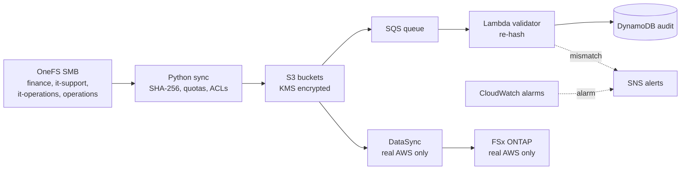

# NAS-to-AWS Migration Factory (LocalStack / moto)

[](https://github.com/chanawh/nas-to-aws-migration/actions/workflows/ci.yml)

The AWS twin of the Azure migration factory. Same source NAS, same
story, different cloud: 80 TB on-prem NAS, 400+ users over SMB/NFS,
12-month datacenter exit, zero unplanned downtime, checksum-verified
integrity. The lab is a scale model: 4 shares, 12 users, 24 files,
~1.16 MB. The sync engine cannot tell the difference.

**Cost: $0.** Everything runs in a local AWS emulator, LocalStack
or moto, no AWS account, no cloud bill. One real AWS run is
under $1 for a day, see `docs/REAL_AWS_ONE_DAY.md`.

**Honest limits, up front:** the base dataset is 24 files, not
80 TB; a scaled run migrated 10,024 objects / 10.49 GB through
the same engine against a local disk-backed S3 emulator
(Garage), see `docs/SCALED_RUN.md`. LocalStack was not run
live here, moto was. The Lambda function
was created in moto, its handler was tested directly, not by
invoking through moto's Lambda mock. FSx, DataSync and CloudTrail
are real-AWS only and gated off. This is a lab project, labelled
as one, and the Terraform is the same code as a real AWS run.

## Reviewer path (5 minutes)

1. Results table below. 2. Failure matrix,
   `docs/FAILURE_MATRIX.md`. 3. `docs/adr/0002-sha256-not-etag.md`
   (why SHA-256, not ETags). 4. `docs/COST.md` (list-price model,
   no real spend yet). 5. Any runbook in `docs/`.

## Results (measured)

| Metric | Result | Evidence |
|---|---|---|
| Scale run | 50,024 objects / 52.43 GB to Garage S3 emulator, 25.8 MB/s at 4 workers | `evidence/scaled-run-50gb-2026-11-24.json` |
| Parallel throughput | 1 worker 17.57 MB/s median; 4 workers 19.77 MB/s (1.13x); 8 workers 17.32 MB/s (~1.0x) | `evidence/throughput-2026-11-24.json` |
| Failure matrix | 6 drills, 3 runs each, all detected and recovered | `evidence/failure-matrix-2026-11-24.json` |
| Ransomware drill | 10 overwritten + 10 deleted of 24; all 20 restored, 0 data loss | same file, `ransomware` drill |
| Azure Blob side | Blob engine 9/9 tests; 6 drills, 3 runs each, all detected and recovered (Azurite) | `evidence/azure-failure-matrix-2026-11-24.json`, `docs/AZURE_BLOB.md` |
| Integrity | 0 mismatches on every verify; 10/10 injected corruptions detected and repaired | `evidence/scaled-run-10gb-2026-11-22.json` |
| Cost | list-price model only; no real AWS spend exists | `docs/COST.md` |
| Real-cloud drill readiness (v1.2.1) | drills take real paths on real AWS/Azure with dynamic backend labels (no stub on real cloud); OIDC workflow dispatch is the primary path | `docs/REAL_AWS_ONE_DAY.md`, `docs/AZURE_BLOB.md`, `.github/workflows/real-aws.yml` |

The parallel number is the honest one, not the hoped-for one:
on the local emulator parallelism buys ~13% at 4 workers and
nothing at 8 — the bottleneck is the emulator, not the client.
See `docs/THROUGHPUT.md`. Real-S3 numbers are pending a real
AWS run; the OIDC workflow (`.github/workflows/real-aws.yml`)
is written but untested.



## Who built this, and why

Andrew Chan, Technical Support Engineer II at Dell
Technologies since December 2018, escalation point for
150+ enterprise Dell PowerScale (OneFS) environments and
1,400+ high-severity incidents, with 15+ Python, Bash and
PowerShell automation tools and 20+ runbooks built on the
job. Certifications held: AWS Solutions Architect
Professional, CKA, Terraform Associate, RHCE, CCNA.

This project exists because support work alone does not
prove build skill. It takes the exact work a PowerScale
TSE does, file shares, quotas, ACLs, replication,
checksum-verified integrity, cutovers, and rebuilds it
as cloud infrastructure, with Terraform and Python,
proven in CI. Target roles: Cloud Support Engineer,
Cloud Operations, Storage and Platform Engineer.

## What this proves for a cloud role

| PowerScale TSE experience | Cloud proof in this repo |
|---|---|
| SyncIQ replication, datacenter exits | Python sync engine to S3, DataSync to FSx on real AWS, cutover runbook |
| SmartQuotas, share quotas | Per-share quotas checked before any copy, DynamoDB audit per object |
| SMB / NFS shares, ACLs | One S3 bucket per share, ACL-to-tag mapping, FSx as the file-system target |
| OneFS Platform API, automation | Terraform for 41 AWS resources, boto3 sync and verify, Lambda validator |
| High-severity incident handling | Corrupt-object drill: verify FAILs on exactly one file, re-sync repairs it |
| Runbooks | `docs/CUTOVER_RUNBOOK.md`, failure drills, system design and ADRs |

**For hiring managers and interviewers:** start at
`docs/INTERVIEW_GUIDE.md`. It has the STAR bullet, the
30-second pitch, and the ten questions you will be asked,
with answers. CI runs the whole project on every push:
22 unit tests, Terraform fmt/validate, and the full demo
against moto, see `.github/workflows/ci.yml`.

**System design:** `docs/SYSTEM_DESIGN.md` covers
requirements, scale and capacity at 80 TB, the data model,
failure modes, security, observability, cost, tradeoffs,
and what to do next at real scale. `docs/adr/` holds the
five architecture decisions, each with context, decision,
and consequences. `SECURITY.md` states what is safe and
what is lab-only. That is the 2026-competitive part: not
just code that runs, but a design a reviewer can argue
with, and evidence that the argument was thought through.

## AWS services used

| Service | What it does here | Runs in emulator? |
|---|---|---|
| S3 | 4 buckets, one per share; versioning, KMS encryption, Glacier lifecycle | Yes - LocalStack and moto |
| IAM | Migration user, least-privilege policy; Lambda validator role | Yes |
| KMS | Customer-managed key for S3 encryption, rotation on | Yes |
| DynamoDB | Audit table, one item per object per sync, 90-day TTL | Yes |
| SNS | Alerts topic; verify FAIL and CloudWatch alarms publish here | Yes |
| SQS | Event queue (S3 ObjectCreated) + DLQ, 3 retries | Yes |
| Lambda | Validator: re-downloads each new object, re-hashes it, writes the verdict to DynamoDB | Created in moto; execution is mocked there - handler is unit-tested directly |
| CloudWatch | Log group for the validator; alarms on Lambda errors and on a stuck validation queue | Yes |
| FSx for NetApp ONTAP | File-share target, 1024 GiB, with an SVM and volume | **No - real AWS only**, gated off by `enable_fsx_datasync = false` |
| DataSync | Task S3 -> FSx, verify POINT_IN_TIME_CONSISTENT, UID/GID BOTH | **No - real AWS only**, same gate |
| CloudTrail | Multi-region trail logging every API call to its own bucket | **No - real AWS only**, gated off by `enable_cloudtrail = false` |

Flow: OneFS SMB -> Python sync -> S3 (KMS) -> S3 event -> SQS -> Lambda validator -> DynamoDB audit, with SNS on failure and CloudWatch watching the validator. On real AWS, DataSync then copies S3 to FSx for the applications that need a file system. Total Terraform: 41 resources to add on an emulator run, up from 23 before these services.

Use the new flags to wire the CLI in: `sync --dynamodb-table nas2aws-migration-audit` writes 24 audit records, `verify --sns-topic-arn <arn>` publishes on FAIL. Set `alert_email` in Terraform to get the SNS alerts by email.

## The one honest difference from Azure

S3 is object storage, not a file share. There is no SMB/NFS mount,
no Azure Files share, no ANF volume. Files land as S3 objects, one
bucket per share, with the SHA-256 in object Metadata and Tags.
EFS and FSx for NetApp - the true Azure Files / ANF analogues - are
not emulated for free: EFS is LocalStack paid-only, FSx is not
emulated at all. This project does not pretend otherwise.

## What is in here

| Path | What it is |
|---|---|
| `terraform/` | 4 S3 buckets (versioning, SSE-S3, public-access block, Glacier lifecycle), least-privilege IAM migration user |
| `python/migrate_s3/` | S3 sync engine (SHA-256 in metadata, quota, ACL pre-flight, manifest in S3, verify by re-download) |
| `python/tests/` | 10 unittest tests, moto in-process mock, no server needed |
| `docker-compose.yml` | LocalStack 4.14.0, the primary emulator |
| `scripts/start_moto.sh` | moto server, the no-Docker fallback used to run this in the VM |
| `scripts/run_local_demo.sh` | Full live demo against moto: Terraform apply, sync, verify, corrupt, repair |
| `scripts/run_scaled_demo.py` | Scaled run (default 10,000 x 1 MB files) against any S3 endpoint: sync, verify, corrupt, repair, JSON evidence |
| `docs/SCALED_RUN.md` | The 2026-11-22 10 GB run: backend choice, timings, cost model |
| `docs/CUTOVER_RUNBOOK.md` | The cutover procedure, step by step |
| `docs/ONEFS_VIRTUAL_NODE.md` | The source side: OneFS Simulator virtual node in VMware Workstation Pro, mount, seed, migrate |
| `python/migrate_s3/onefs.py` | OneFS bridge: check-onefs, mount/unmount, seed-onefs, mount-root validation |
| `scripts/onefs/setup_onefs.sh` | Run on the OneFS node: create the 4 SMB shares, Everyone lab access, SmartQuotas |
| `scripts/mount_onefs.ps1` / `.sh` | Mount the 4 OneFS shares on a Windows / Linux host |

## Emulators, ranked

1. **LocalStack 4.14.0 (primary, Docker required).** `docker compose up -d`.
   Pinned to 4.14.0, the last community release that runs without a paid
   auth token. From 2026.03.0 onward even the free Hobby tier needs a
   LocalStack account and auth token. Endpoint: http://localhost:4566.
2. **moto server (fallback, no Docker).** `bash scripts/start_moto.sh`.
   Pure Python, same S3 API, endpoint http://localhost:5000. This is
   what ran live in the VM, because Docker is not installed there.
   State is in-memory: stop the server and the buckets are gone.
3. **Real AWS.** Set `use_emulator = false`, `endpoint_url = ""`, use
   real credentials from env vars. Bucket names must be globally unique;
   change `bucket_prefix` first. Cost is S3 Standard at ~$0.023/GB/month
   for the lab data - cents - plus nothing else if you destroy after.

The Terraform and Python code take one flag, the endpoint URL. That
flag is the only difference between the three. Nothing else changes.

## Quickstart - tests only, no emulator, 1 minute

```bash
cd python
~/workspace/nas-to-aws-migration-venv/bin/python -m unittest discover -s tests -v
```

Expected: 10 tests, OK. In this VM the venv is at
`~/workspace/nas-to-aws-migration-venv/`; on your machine create your
own with `python3 -m venv .venv && .venv/bin/pip install boto3 "moto[server]"`.

## Quickstart - full live demo against moto, 5 minutes

```bash
bash scripts/run_local_demo.sh
```

That starts moto on :5000, runs `terraform init / validate / apply`
against it, generates the dataset, syncs it to S3, verifies it,
corrupts one object, shows verify catching it, re-syncs to repair it,
then destroys and stops the server. Expected: 24 objects, verify PASS,
then FAIL on the corrupted object, then PASS again.

## OneFS virtual node as the source (VMware Workstation Pro)

The default source is a synthetic directory. The real source is a
OneFS Simulator virtual node in VMware Workstation Pro. Full guide:
`docs/ONEFS_VIRTUAL_NODE.md`. Short version, on the Windows host:

1. Download the OneFS Simulator 9.12 from Dell (free, non-production,
   477 MB; 6 GB RAM recommended per node, 100 GB disk, VMware
   Workstation supported). Import it, set the network to **Bridged**,
   give it a static IP, e.g. 192.168.1.50, and finish the first-boot wizard.
2. On the node, over SSH: `ssh root@192.168.1.50 'sh -s' < scripts/onefs/setup_onefs.sh`
   That creates the 4 SMB shares and the SmartQuotas.
3. On the host: `.\scripts\mount_onefs.ps1 -OneFSHost 192.168.1.50 -MountRoot C:\nas2aws\onefs`
4. Check it: `python -m migrate_s3.cli check-onefs --onefs-host 192.168.1.50`
5. Seed it, then sync from it:
   ```bash
   python -m migrate_s3.cli generate --root /tmp/nas2aws-source
   python -m migrate_s3.cli seed-onefs --source /tmp/nas2aws-source --mount-root C:\nas2aws\onefs
   python -m migrate_s3.cli sync --source C:\nas2aws\onefs --source-mode onefs --onefs-host 192.168.1.50 --endpoint-url http://localhost:4566
   python -m migrate_s3.cli verify --source C:\nas2aws\onefs --source-mode onefs --onefs-host 192.168.1.50 --endpoint-url http://localhost:4566
   ```
   The OneFS node itself was not run in this VM (no Workstation Pro,
   no simulator here). The integration was tested here against a local
   directory standing in for the mount root, with the same layout and
   the same sync/verify path. The first live run against your node is
   still yours to confirm.

## Quickstart - LocalStack (your machine, Docker)

```bash
docker compose up -d
cd terraform
terraform init
terraform validate
terraform apply -var="endpoint_url=http://localhost:4566"
cd ../python
python -m migrate_s3.cli generate --root /tmp/nas2aws-demo/source
python -m migrate_s3.cli sync --source /tmp/nas2aws-demo/source --endpoint-url http://localhost:4566
python -m migrate_s3.cli verify --source /tmp/nas2aws-demo/source --endpoint-url http://localhost:4566
```

## Cost

LocalStack Hobby and moto: $0, no AWS bill. Real AWS, lab data:
S3 Standard storage for 1.16 MB is under a cent a month; the only
real cost is forgetting to destroy the buckets, and even then it is
cents. At production scale, 80 TB in S3 Standard is ~$1,850/month,
and Glacier after 90 days is the lever - that is what the lifecycle
rule in `terraform/s3.tf` is for.

## What was run live, and what was not

- Python engine: 25/25 S3 tests pass live, moto in-process mock, Python
  3.12.3, boto3 1.44.6 (13 S3 sync incl. parallel + multipart, 8 OneFS, 4 new services).
- Azure Blob engine: 9/9 tests pass live against Azurite 3.38.0
  (azure-storage-blob 12.31.1), plus 6 Blob drills 3/3 — see
  `docs/AZURE_BLOB.md` and
  `evidence/azure-failure-matrix-2026-11-24.json`. Soft delete,
  immutability, genuine throttling, and Terraform apply are
  real-Azure-only.
- Parallel sync (v1.2.0): `--workers` on the CLI, multipart upload
  for files >= 8 MiB. Measured on Garage: 1.13x at 4 workers,
  ~1.0x at 8 — see `docs/THROUGHPUT.md` and
  `evidence/throughput-2026-11-24.json`.
- Failure drills (v1.2.0): six failure classes + ransomware, each
  run 3 times, all detected and recovered — see
  `docs/FAILURE_MATRIX.md` and
  `evidence/failure-matrix-2026-11-24.json`. KMS denial and
  genuine throttling are simulated (the emulators do not produce
  them); Object Lock enforcement is real-AWS-only.
- Terraform + CLI end to end: run live against a moto server on
  :5000 in this VM (Docker is not installed here, so LocalStack
  itself was not run live here). `terraform fmt`, `validate`, `plan`
  and `apply` all ran against moto; the CLI sync/verify/corrupt/repair
  ran against the same server. See `scripts/run_local_demo.sh`.
- Added services, run live against moto on :5003: plan 41 to add,
  apply 41 added, sync 24 files with `--dynamodb-table` wrote 24
  DynamoDB audit records (verified by scan), SNS topic and both SQS
  queues listed live, verify PASS on all shares, destroy 41 destroyed.
  The DataSync/FSx/CloudTrail resources were validated only
  (`terraform validate` clean) with their gates off - they are real
  AWS only, and enabling them against an emulator will fail by design.
  The Lambda function was created in moto; its handler was tested
  directly in the unit tests, not by invoking through moto's Lambda
  mock.
- Scaled run, 2026-11-22: 10,024 objects / 10,486,923,264 bytes
  synced through the unmodified engine against Garage v1.3.0
  (local disk-backed S3 emulator, not real AWS): sync 776.07s
  (13.5 MB/s local), verify PASS with zero mismatches, 10/10
  injected corruptions detected, repair re-uploaded exactly
  10, final verify PASS. Evidence in
  `evidence/scaled-run-10gb-2026-11-22.json`, method in
  `docs/SCALED_RUN.md`.
- LocalStack 4.14.0: not run live in this VM (no Docker). The
  docker-compose file and the endpoint flag are written for it, and
  the S3 API calls are identical - but the first LocalStack run on
  your machine is still yours to confirm.
- Real AWS: not run. No AWS account is connected here.

## Resume bullet (use only after a clean verify against an emulator or real AWS)

> Built a Terraform-provisioned NAS-to-AWS migration factory on
> LocalStack: migrated a simulated 80 TB, 400-user NAS to S3 with a
> Python sync engine using SHA-256 metadata verification, per-share
> quotas, and ACL-to-tag mapping; KMS-encrypted buckets, a Lambda
> validator re-checking every object into a DynamoDB audit table,
> SQS/SNS alerting and CloudWatch alarms; 24-file lab dataset verified
> 100% checksum-clean, cutover runbook and failure drills documented.

Label it as a lab / emulator project. Never present the 80 TB as data
you moved in production, and never present LocalStack as real AWS.
