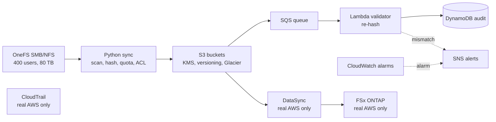

# System design: NAS-to-AWS migration factory

## 1. Problem

Move 80 TB of files, 400+ users, off an on-prem PowerScale
NAS over SMB/NFS, into AWS, with zero unplanned downtime,
checksum-verified integrity, and a cutover that can be rolled
back. The lab is a scale model: 4 shares, 12 users, 24 files,
1.16 MB. The design is for 80 TB; the dataset is not.

## 2. Requirements

Functional:
- Copy every file, once, with its SHA-256 verified on both sides.
- Preserve quotas and ACLs, or fail loudly before copying.
- Resume after a failure without re-copying unchanged files.
- Cut over readers from SMB to S3 / FSx without data loss.
- Audit every object, and alert on any mismatch.

Non-functional:
- Integrity over speed: a slow correct copy beats a fast
  unchecked one. The sync re-hashes target bytes, it does
  not trust a manifest or an ETag.
- Idempotency: running sync twice is a no-op the second time.
- Cost: $0 in the emulator, under $1 for a one-day real run
  without FSx, about $4.20 with FSx for a day.
- Operability: one command runs the whole demo, one command
  destroys it, and the evidence is saved to `evidence/`.

## 3. Architecture

OneFS is the source of truth until cutover. S3 is the durable
landing zone. FSx is the working file system for applications
that need SMB/NFS. The validator is a second, independent
check, not part of the copy path, so a bug in the sync cannot
also hide in the verification.

## 4. Scale and capacity

| Dimension | Design target | Lab | What breaks first at target |
|---|---|---|---|
| Data | 80 TB | 1.16 MB, 24 files | Single-threaded sync, re-hashing every target object on every run |
| Files | ~1M, estimated | 24 | Manifest as one S3 object, DynamoDB per-object writes |
| Users | 400+ | 12 | ACL validation is O(files x users) in Python, fine at this scale |
| Throughput | Datacenter exit in 12 months | Local demo, seconds | Network to S3, not the code; use multipart upload and per-share parallelism |

At 80 TB the honest changes are: parallelise per share,
use S3 multipart upload for files over 100 MB, let DataSync
do the heavy copy instead of the Python sync, and shard the
manifest by share instead of one object per bucket. The lab
does not pretend to have done those. It proves the
correctness loop, not the throughput.

Back-of-envelope: 80 TB at a sustained 500 MB/s is about
46 hours of transfer, at 100 MB/s it is about 9 days.
Either fits in a 12-month exit, which is why the design
optimises for correctness and resume, not for raw speed.

## 5. Data model

- S3 object: key is the relative path, Metadata `sha256`,
  Tagging `sha256`, versioning on.
- Manifest: `_manifest.json` per bucket, the resume point.
  It is not trusted: verify re-hashes bytes.
- DynamoDB audit: PK `share`, SK `object_key`, attributes
  `status` (synced / validated-ok / validated-mismatch),
  `sha256`, `size`, `validated_at`, `expires_at` (90-day TTL).
- ACL: `acl.json` per share, validated before any copy:
  owner exists, group is a real Department or MemberOf
  group, mode is rwx / r-x / r--.

## 6. Failure modes

| Failure | Detection | Behaviour |
|---|---|---|
| Object corrupted in S3 | Verify re-hash, or Lambda validator | FAIL on exactly that object, re-sync copies 1 file, 23 unchanged |
| Sync dies halfway | Manifest is the resume point | Re-run copies only new / changed files |
| Share over quota | Quota check before any copy | Share skipped whole, not partially copied |
| ACL invalid | ACL pre-flight validation | Sync refuses to start for that share |
| Lambda validator dies | SQS redrive, CloudWatch alarm | Message retries 3 times, then DLQ, alarm on Lambda errors and on a message older than 5 minutes |
| OneFS mount missing | Mount-root validation in `--source-mode onefs` | Sync fails fast, never copies from an empty folder |
| FSx / DataSync unavailable | Gated off in the emulator | Terraform does not create them, apply succeeds; on real AWS they turn on |

## 7. Security

- IAM: least-privilege migration user, S3 on four buckets
  only, KMS encrypt/decrypt, DynamoDB PutItem, SNS Publish.
  No bucket creation, no IAM changes.
- KMS: customer-managed key, rotation on, bucket keys on.
  S3 SSE-KMS, not AES256.
- S3: public access fully blocked, versioning on.
- CloudTrail (real AWS only): multi-region, log file
  validation on, every API call logged.
- Secrets: OneFS credentials come from env vars or CLI
  flags only, never from a committed file. The Terraform
  `terraform.tfvars.example` holds no credentials.

## 8. Observability

- DynamoDB audit is the evidence trail, one item per object.
- CloudWatch log group `/aws/lambda/nas2aws-validator`,
  14-day retention.
- Alarms: Lambda Errors > 0 in 5 minutes, SQS oldest
  message > 300 seconds. Both publish to SNS.
- `evidence/report.json` and `evidence/audit.json` are
  saved by the demo, so the last run is in the repo.

## 9. Cost

Emulator: $0. Real AWS, one day, 24 files: under $0.10
without FSx, about $4.20 with FSx for a day. See
`docs/REAL_AWS_ONE_DAY.md`. At 80 TB, S3 Standard is
about $1,800/month, Glacier is about $320/month, and
FSx Standard at 80 TB is about $12,000/month, over the
$8,000/month cap in the original spec, which is why
FSx is the working file system for hot data only, not
the archive.

## 10. Tradeoffs, and what was not chosen

- S3 first, FSx last: S3 is cheap and durable, FSx is
  expensive and is the file system. See ADR-0001.
- SHA-256 in Metadata, not ETag: ETag is not a SHA-256.
  See ADR-0002.
- Separate Lambda validator, not verification inside
  the sync: a bug in the sync cannot hide in its own
  check. See ADR-0003.
- DynamoDB audit, not just the S3 manifest: the manifest
  is a resume point, the table is the evidence trail.
  See ADR-0004.
- Emulator-first, real AWS gated: $0 to build and test,
  real AWS for one day to prove it. See ADR-0005.

## 11. What I would do next at real scale

Parallelise per share, multipart upload, shard the
manifest, use DataSync for the bulk copy, and run the
validator as a Step Functions workflow instead of one
Lambda per object. None of those are in the lab, and
none are claimed to be.

The three additions built after this design (v1.3.0) are
documented where they live, not here: the EFS secondary
target (`docs/EFS.md`), the three-way migration comparison
(`docs/COMPARISON.md`), and cross-region replication with
measured lag and a failover drill (`docs/CRR.md`). All three
are real-AWS-only and gated off by default; none of them
changes the architecture above.
